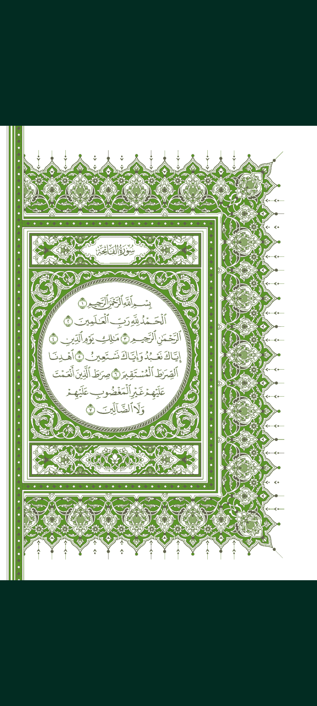
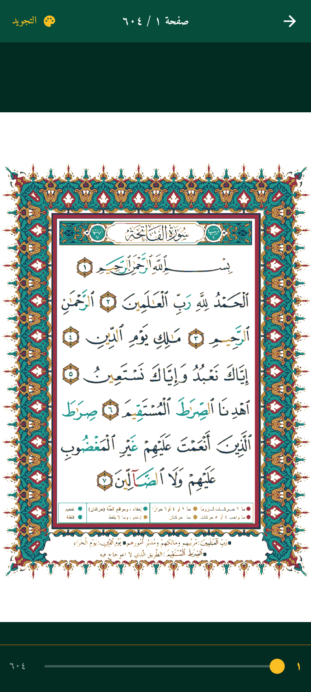

# بيان القرآن — Bayan Quran

An offline-first Flutter Quran reader. The app ships with the full Uthmani
text (114 surahs, 6,236 ayahs) in a bundled SQLite database, so it works with no
network connection. It runs on Android, iOS, desktop and the web.

## Features

- **Surah index** — all 114 surahs with Arabic/English names, revelation type
  and verse counts.
- **Reader** — Uthmani script in the `UthmanicHafs` font with a line height of
  `2.1` so tashkeel is never clipped, plus an adjustable font size.
- **Clean Quranic glyphs** — the bundled font draws five Quranic annotation
  marks (`U+06DF`, `U+06E3`, `U+06EA`, `U+06EB`, `U+06ED`) as one oversized
  filled circle, which reads as a stray black dot. The DB builder maps
  `U+06DF` to the correctly drawn `U+06E0` (same "zero" mark) and drops the
  other four, which have no same-position glyph in this font.
- **Basmala handling** — Surah 1 keeps the Basmala as its first verse, Surah 9
  has none, and Surahs 2–114 show a single decorative `BasmalaHeader` with any
  duplicate Basmala stripped from verse 1.
- **Full-text search** — queries the precomputed `text_search_normalised`
  column and highlights the match inside the still-diacritised display text.
- **Colour-coded Tajweed mode** (وضع التجويد الملون) — a toggle in the reader
  recolours the verse with the authentic Tajweed Mushaf palette (madd, ghunnah,
  qalqalah, silent letters). The preference is persisted, and an in-app colour
  guide explains each rule.
- **Bookmarks** — long-press a verse to remember the last read position.
- **Page-by-page Mushaf** (المصحف) — swipe through the 604 printed Madani
  pages. Two aligned editions ship side by side: the plain Uthmani Mushaf and
  the colour-coded Tajweed Mushaf, switchable from the reader and persisted.
- **Light/dark themes** with an emerald and gold palette.

## Architecture

Feature-first Clean Architecture. Each feature owns its `data`, `domain` and
`presentation` layers; shared infrastructure lives in `lib/core`.

```
lib/
  core/
    constants/          colours and shared constants
    database/           DatabaseHelper + per-platform SQLite bootstrap
    theme/              Material themes
    utils/              Arabic normaliser
  features/
    surah_index/        surah list
    quran_reader/       ayah reader
    search/             full-text search
    bookmarks/          last-read position
    mushaf/             page-by-page Mushaf editions
```

State management uses `flutter_bloc` cubits. The database is opened read-only
because the bundled asset never changes.

## Cross-platform SQLite

`sqflite` has no desktop or web implementation, so `lib/core/database/platform/`
picks a backend at compile time via a conditional export:

| Target                  | Backend                                |
| ----------------------- | -------------------------------------- |
| Android / iOS           | `sqflite` plugin                       |
| Linux / Windows / macOS | `sqflite_common_ffi`                   |
| Web                     | `sqflite_common_ffi_web` (wasm SQLite) |

The bundled `assets/quran.db` is seeded into a writable location (a file on
native/desktop, IndexedDB on the web) the first time the app runs.

### Web binaries

The web build needs two binaries in `web/`:

- `sqlite3.wasm` — SQLite compiled to WebAssembly
- `sqflite_sw.js` — the shared worker that hosts it

Both are committed so `flutter build web` works offline. Regenerate them with:

```bash
dart run sqflite_common_ffi_web:setup --force
```

## Getting started

```bash
flutter pub get
flutter analyze          # must report 0 issues
flutter test             # unit + widget tests
flutter run              # pick a device
flutter build web --release
```

## Database builder

`assets/quran.db` is generated, not hand-edited:

```bash
python3 tools/build_quran_db.py
```

The script downloads the Uthmani text, the Uthmani Tajweed text and chapter
metadata from the [quran.com v4 API](https://api.quran.com), normalises the
text for search, strips the duplicate Basmala from verse 1 (except Surah 1),
and writes:

- `surahs(id, name_ar, name_en, type, total_verses, start_page)`
- `ayahs(id, surah_id, verse_number, text_uthmani, text_tajweed,
  text_search_normalised, page_number, juz, hizb)`

`text_tajweed` holds the same verse annotated with `<tajweed class="…">` markup
from the `uthmani_tajweed` edition. The builder strips the `<span class="end">`
verse markers, removes stray characters left by malformed source tags (for
example the orphan `>` in 32:3) and applies the same glyph sanitiser as the
plain column, so both columns render identically.

Responses are cached in `tools/cache/` (gitignored). Pass `--offline` to build
from the cache without network access.

### Tajweed mode

The reader parses the `text_tajweed` markup at render time with a tolerant
stack-based parser (`lib/features/quran_reader/presentation/widgets/
tajweed_text_span.dart`). It accepts both the quran.com class names
(`ham_wasl`, `madda_normal`, …) and the published Tajweed specification aliases
(`hamzat_wasl`, `madd_2`, …), maps them onto six palette colours, and never
throws on malformed input — unclosed tags are closed at end-of-text and orphan
closing tags are ignored. Unknown classes inherit the enclosing colour.

The edition splits some grapheme clusters across tag boundaries — a rule span
can begin with a combining mark whose base letter sits in the previous run. A
run that starts with a combining mark is shaped in isolation and the engine then
draws the OpenType dotted-circle fallback (`◌`) under it. The parser therefore
binds every leading mark back to its base: when the marks carry the rule the
base is pulled forward into the coloured run, and when the base carries the rule
the marks are absorbed backwards so the rule colour is preserved. A corpus-wide
test (`test/database_test.dart`) asserts no span ever begins with a combining
mark.

### Arabic normalisation

The normaliser strips diacritics and tatweel, folds alif variants to bare alif,
`ة` to `ه` and `ى` to `ي`, and collapses whitespace. The Dart implementation in
`lib/core/utils/arabic_normalizer.dart` must stay byte-identical to
`normalize_arabic()` in `tools/build_quran_db.py`; a fixture-based test
(`test/fixtures/normalisation_cases.json`) guards the parity.

## Mushaf PDF pipeline

`tools/process_mushaf_pdf.py` turns Madani Mushaf PDFs into the optimised WebP
pages used by the page-by-page Mushaf reader. Two editions ship side by side
and are aligned page-for-page, so `page_001.webp` of each shows the same
Qur'anic page and switching edition keeps the reader in place:

| edition    | source                                    | first PDF page | height | colours | size    |
| ---------- | ----------------------------------------- | -------------- | ------ | ------- | ------- |
| `standard` | طبعة مجمع الملك فهد (plain Uthmani)         | 4              | 1260   | 4       | ~31 MB  |
| `tajweed`  | مصحف التجويد الملون (colour-coded Tajweed)  | 1              | 1260   | 5       | ~34 MB  |

The standard scan opens with three cover leaves, so its Qur'an page 1 is PDF
page 4; the Tajweed scan starts straight at Al-Fatihah.

The `palette` encoder is what makes the pages small: it flattens the scanner's
paper grain to pure white, then quantises the remaining flat colours and writes
lossless WebP. Both editions land under the 35 MB budget.

```bash
pip install pymupdf Pillow

# Both editions from the cached PDFs
python3 tools/process_mushaf_pdf.py --edition standard \
    --input tools/cache/standard.pdf --output assets/mushaf/standard
python3 tools/process_mushaf_pdf.py --edition tajweed \
    --input tools/cache/tajweed.pdf --output assets/mushaf/tajweed

# Download the public-domain PDF first
python3 tools/process_mushaf_pdf.py --edition tajweed --url <pdf-url>

# Render a subset while iterating
python3 tools/process_mushaf_pdf.py --edition standard \
    --input tools/cache/standard.pdf --pages 1-10
```

Options: `--edition` (`standard` / `tajweed`, sets the page offset and
compression preset), `--input` / `--url` (mutually exclusive), `--output`,
`--cache` (where a `--url` download is cached), `--pages` (a 1-based selection
such as `1-10` or `1,5,9`) and the overrides `--first-page`, `--height`,
`--encoder` (`palette` / `lossy`), `--colors`, `--flatten-threshold` and
`--quality`.

The generated WebP pages are build artefacts (gitignored): run the tool once
after cloning to enable Mushaf mode. The `assets/mushaf/<edition>/` directories
are committed so the build finds them even before the tool has run.

## Testing

```bash
flutter test
```

Tests run against the real bundled database through `sqflite_common_ffi`; the
database is never mocked. Coverage includes surah/ayah counts, the Basmala
rules, normaliser/Python parity, offset mapping, and search highlighting.

## Screenshots

The page-by-page Mushaf in both editions, captured at a 412×915 mobile
viewport:

| Standard (المصحف) | Tajweed (التجويد) | Controls |
| --- | --- | --- |
|  |  |  |

Tapping the page toggles the chrome: the app bar carries the edition switcher
and the Arabic page counter, and a page slider sits along the bottom edge.

## License

See [LICENSE](LICENSE).
